<!--
  GitHub Profile README
  Keep this profile focused on engineering work, open-source collaboration,
  and the projects that best represent your skills.
-->

---

## Featured Projects

### 1. TraverseVPN — iOS VPN Application

Native iOS development on a VPN application, working across app experience, connectivity, subscriptions, and supporting services.

- Building with **Swift, SwiftUI, and WireGuardKit**.
- Working with **Network Extension** and VPN connection lifecycle flows.
- Integrating Firebase authentication, Firestore, analytics, and crash reporting.
- Implementing subscription and paywall flows with **RevenueCat**.
- Working on attribution, deep links, and app reliability.

*Project work includes hands-on iOS engineering and integration across native and backend services.*

### 2. SOLACE — AI-Powered Safety & Support App

An iOS application designed to support women experiencing abuse through discreet safety workflows, emotional support, and access to legal information.

- Native iOS client built with **Swift and SwiftUI**.
- Discreet SOS workflows using image steganography.
- AI-powered companion and conversational support.
- Legal guidance powered by retrieval-augmented generation (RAG).
- Supporting services use technologies including **Python, FastAPI, MongoDB Atlas, and Google Gemini**.

---

## Technical Skills

| Area | Technologies |
|---|---|
| **iOS Development** | Swift, SwiftUI, UIKit, Xcode, WireGuardKit, Network Extension |
| **Frontend** | React, Next.js, TypeScript, JavaScript, HTML, CSS, Tailwind CSS |
| **Backend** | Node.js, Express.js, Python, FastAPI, REST APIs |
| **Databases** | Firebase, Firestore, MongoDB, PostgreSQL, MySQL |
| **AI Integration** | Google Gemini, LLM APIs, RAG, MongoDB Vector Search |
| **Tools & Practices** | Git, GitHub, Docker, Postman, CI/CD, debugging |

---

## Let's Connect

I'm always happy to connect with developers, open-source maintainers, and people building useful products.

**Email:** [anubhavcodes7@gmail.com](mailto:anubhavcodes7@gmail.com)

